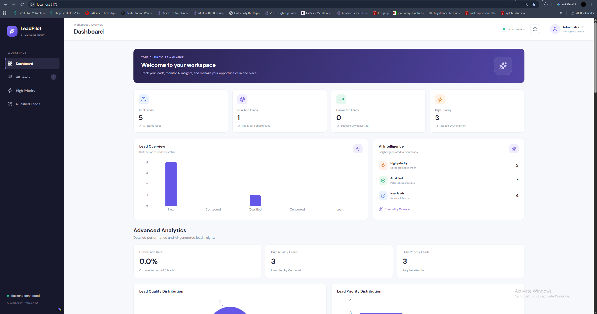
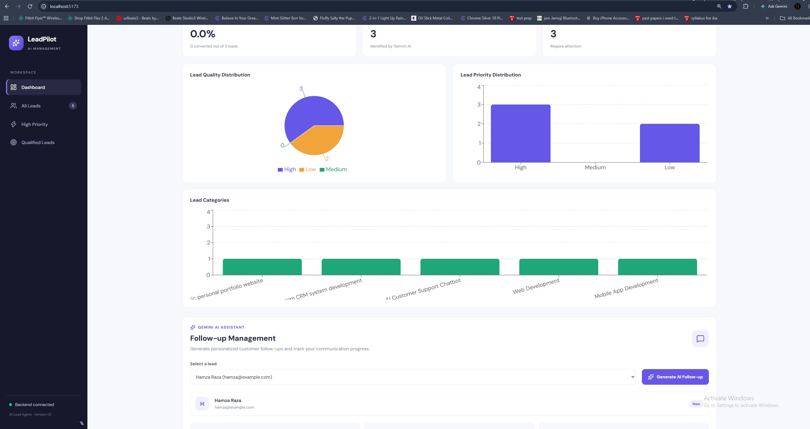
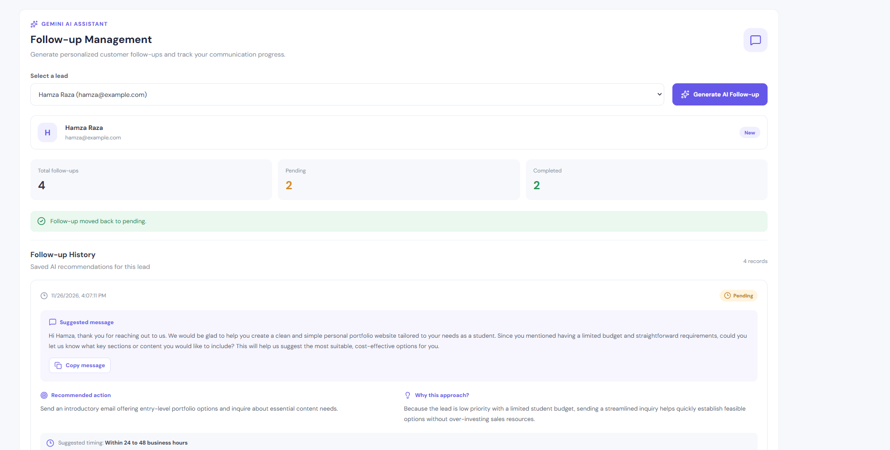
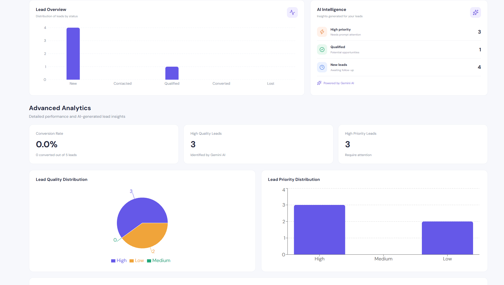

# AI Lead Agent

An AI-powered lead generation, qualification, and management system built with **React, FastAPI, MongoDB, and Google Gemini**.

AI Lead Agent helps businesses manage potential customers, automatically analyze incoming leads, prioritize sales opportunities, and generate personalized AI follow-up recommendations.

## Features

### Lead Management
- Create and store customer leads.
- View all leads in an interactive dashboard.
- Search and filter leads.
- View detailed lead information.
- Update lead statuses.
- Delete leads.

### AI-Powered Lead Analysis
- Analyze customer inquiries using Google Gemini.
- Automatically determine lead quality: High, Medium, or Low.
- Assign lead priority.
- Identify the requested product or service.
- Generate a summary of customer requirements.
- Recommend the next action for the business.

### AI Follow-Up Management
- Generate AI-powered follow-up recommendations.
- Create personalized follow-up messages.
- Display recommended actions and suggested timing.
- Store follow-up history in MongoDB.
- Mark follow-ups as pending or completed.
- Copy generated messages.

### Dashboard and Analytics
- View lead statistics.
- Monitor lead quality and priority distributions.
- Track conversion rates.
- Explore lead categories.
- View recent leads.
- Monitor backend connection status.

## Application Screenshots

### Main Dashboard


### Lead Details and AI Analysis


### AI Follow-Up Manager


### Advanced Analytics


## Technology Stack

| Area | Technology |
|---|---|
| Frontend | React 19, Vite |
| Styling | CSS |
| Icons | Lucide React |
| Charts | Recharts |
| API Communication | Axios |
| Backend | Python, FastAPI |
| Database | MongoDB |
| Database Driver | PyMongo |
| AI Integration | Google Gemini API |
| Data Validation | Pydantic |

## Project Structure

```text
AI-Lead-Agent/
│
├── backend/
│   ├── app/
│   │   ├── database/
│   │   │   ├── connection.py
│   │   │   ├── mongodb.py
│   │   │   └── operations.py
│   │   │
│   │   ├── models/
│   │   │   └── lead.py
│   │   │
│   │   ├── routes/
│   │   │   └── leads.py
│   │   │
│   │   ├── services/
│   │   │   ├── ai_service.py
│   │   │   ├── followup_service.py
│   │   │   └── gemini_service.py
│   │   │
│   │   └── main.py
│   │
│   └── .env
│
├── frontend/
│   ├── src/
│   │   ├── services/
│   │   │   └── api.js
│   │   ├── App.jsx
│   │   └── ...
│   ├── package.json
│   └── ...
│
├── .gitignore
└── README.md
```

## Requirements

- Python
- Node.js and npm
- MongoDB Community Server
- Google Gemini API key

## Installation and Setup

### 1. Clone the Repository

```bash
git clone https://github.com/saifxthetic/AI-Lead-Agent.git
cd AI-Lead-Agent
```

### 2. Backend Setup

Create and activate a virtual environment from the project root:

```bash
python -m venv venv
```

Windows PowerShell:

```powershell
.\venv\Scripts\Activate.ps1
```

Install backend dependencies:

```bash
pip install fastapi==0.165.0 uvicorn==0.54.0 pymongo==4.20.2 google-genai==3.6.1 python-dotenv==1.2.4 pydantic==2.14.4
```

### 3. Configure Environment Variables

Create a `.env` file inside the `backend` directory.

Add your Gemini API key:

```env
GEMINI_API_KEY=your_gemini_api_key_here
```

Never commit your actual API key to GitHub.

### 4. Start MongoDB

Make sure your local MongoDB server is running.

The application connects to:

```text
mongodb://localhost:27017/
```

Database:

```text
ai_lead_agent
```

Collection:

```text
leads
```

### 5. Start the Backend

From the project root:

```powershell
cd backend
python -m uvicorn app.main:app --reload
```

Backend API:

```text
http://127.0.0.1:8000
```

Interactive API documentation:

```text
http://127.0.0.1:8000/docs
```

### 6. Start the Frontend

Open a second terminal and navigate to the frontend directory:

```powershell
cd frontend
npm install
npm run dev
```

Frontend:

```text
http://localhost:5173
```

## API Health Checks

The backend provides the following health-check endpoints:

| Endpoint | Purpose |
|---|---|
| `/` | API status |
| `/health` | Backend health |
| `/db-health` | MongoDB connection status |

## AI Workflow

1. A user submits a potential customer lead through the React dashboard.
2. The frontend sends the lead information to the FastAPI backend.
3. The backend sends the customer inquiry to Google Gemini.
4. Gemini analyzes the lead and returns structured information.
5. The lead analysis is stored in MongoDB.
6. The dashboard displays the lead's quality, priority, category, and recommended action.
7. The user can generate AI-powered follow-up recommendations.
8. Follow-up messages and their statuses are saved for future reference.

## Future Improvements

- User authentication and role-based access.
- Email integration for sending follow-up messages.
- Automated lead scoring and prediction.
- Cloud deployment.
- Advanced reporting and business analytics.

## Author

**Muhammad Ali Saif**

GitHub: [@saifxthetic](https://github.com/saifxthetic)

Project Repository: [AI-Lead-Agent](https://github.com/saifxthetic/AI-Lead-Agent)

---

*AI Lead Agent — Turning potential customers into actionable business opportunities.*
